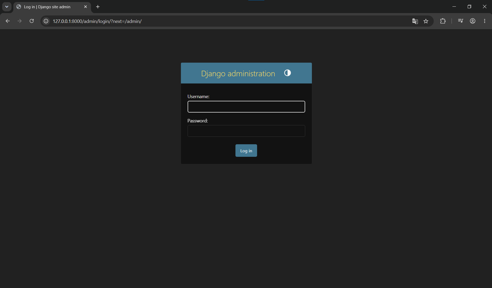
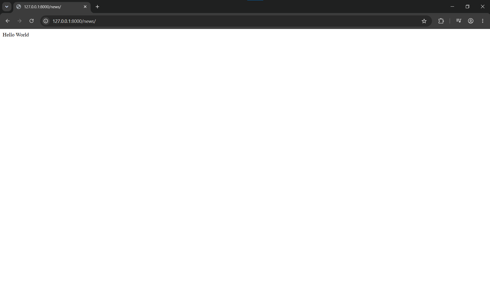
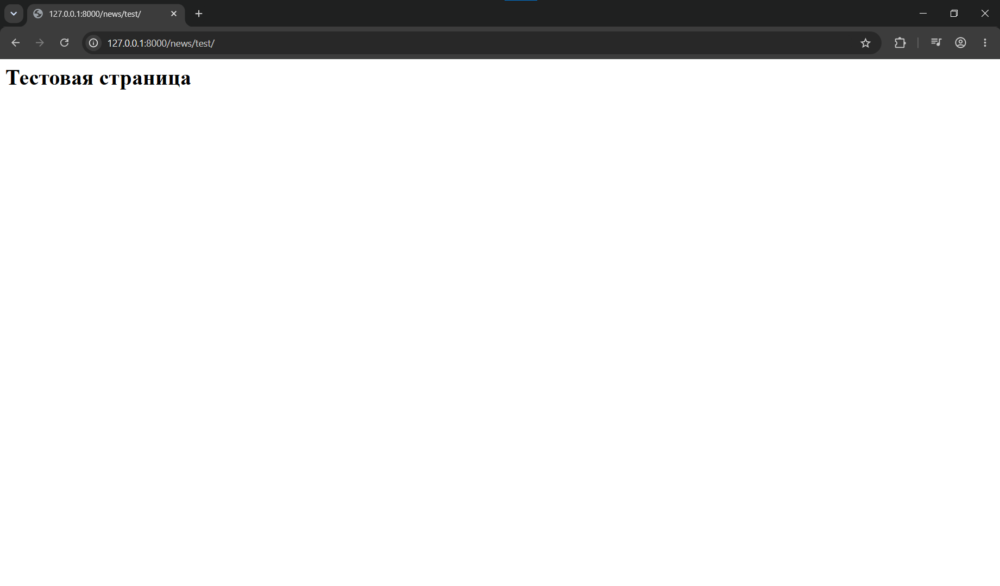

# Лабораторная работа №1: Создание виртуального окружения. Контроллеры и маршруты
**Студент:** Степанян Даниел Эрнестович
**Группа:** ПИЖ-б-о-25-2
**Вариант:** 12
**Технология:** Python + Django

## Содержание
- [Лабораторная работа №1: Создание виртуального окружения. Контроллеры и маршруты](#лабораторная-работа-1-создание-виртуального-окружения-контроллеры-и-маршруты)
  - [Содержание](#содержание)
  - [Цель работы](#цель-работы)
  - [Ключевые понятия](#ключевые-понятия)
  - [Скриншоты работы](#скриншоты-работы)
  - [Вывод](#вывод)

## Цель работы
Получение навыков настройки виртуального пространства, разработки контроллера приложения и организации маршрутов.

## Ключевые понятия 
**Контроллер** - это функция, которая получает HTTP-запрос от клиента, обрабатывает его и формирует HTTP-ответ.

**Маршрут** - это заданный адрес, по которому в Django определяется, какую функцию-контроллер необходимо вызвать при поступлении HTTP-запроса.

**Маршрутизация** - это процесс сопоставления полученного от клиента HTTP-запроса с определённым маршрутом и последующей передачей запроса соответствующему контроллеру.

В Django этим занимается **маршрутизатор**. Его задача - принять запрос клиента, сравнить запрошенный адрес со списком зарегистрированных маршрутов,
найти совпадение и вызвать соответствующую функцию-контроллер (при отсутствии совпадений - вернуть ошибку 404).

## Скриншоты работы

*Маршрут admin*

*Маршрут news*

*Маршрут test, вложенный в приложение news*

## Вывод 
В ходе выполнения лабораторной работы были получены первичные навыки настройки виртуального пространства, разработки контроллера приложения и организации маршрутов с помощью фреймворка Django для Python.