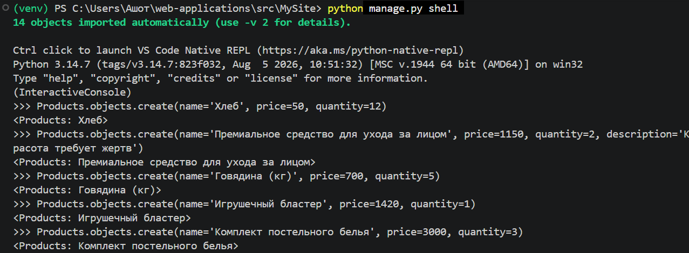
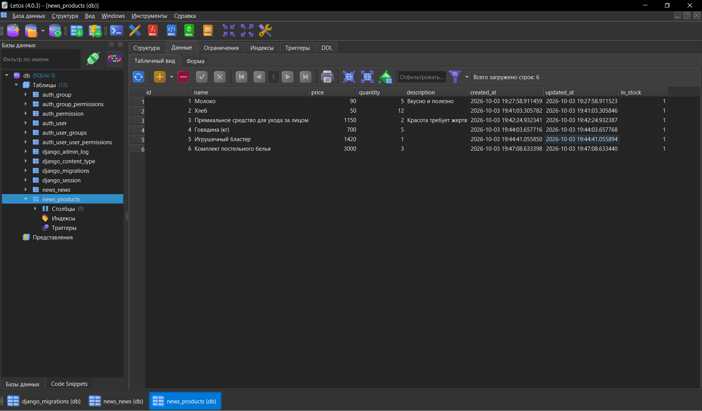
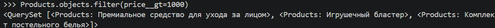

# Лабораторная работа №2: Модели. CRUD
**Студент:** Степанян Даниел Эрнестович
**Группа:** ПИЖ-б-о-25-2
**Вариант:** 12
**Технология:** Python + Django

## Содержание
- [Лабораторная работа №2: Модели. CRUD](#лабораторная-работа-2-модели-crud)
  - [Содержание](#содержание)
  - [Цель работы](#цель-работы)
  - [Ключевые понятия](#ключевые-понятия)
  - [Выполнение индивидуального задания](#выполнение-индивидуального-задания)
    - [Код для индивидуального задания](#код-для-индивидуального-задания)
    - [Скриншоты работы](#скриншоты-работы)
  - [Ответы на вопросы](#ответы-на-вопросы)
  - [Вывод](#вывод)

## Цель работы
Разработка моделей, научиться проводить миграцию данных, работа с базой данных. 

## Ключевые понятия 
**Модель** - ключевой компонент архитектуры MTV (Model-Template-View). Она представляет собой слой данных, отвечающий за хранение и предоставление информации. В Django каждая модель соответствует одной таблице в базе данных и наследуется от класса django.db.models.Model.

**Миграция** (migration) - это файл (или набор файлов), в котором описано изменение структуры базы данных: создание или удаление таблицы, добавление, удаление или изменение поля. В Django миграции создаются автоматически на основе изменений в models.py командой makemigrations и применяются к базе командой migrate. Они хранятся в папке migrations/ приложения и образуют упорядоченную историю изменений схемы БД. 

**ORM (Object-Relational Mapping)** - это API, который позволяет работать с базой данных через объекты и классы языка программирования, не записывая SQL-запросы вручную. В Django модель (класс, наследуемый от models.Model) соответствует таблице, поле класса соответствует столбцу, а экземпляр класса соответствует строке таблицы. ORM сам переводит Python-код в SQL и обратно.

## Выполнение индивидуального задания
В рамках индивидуального задания было необходимо создать модель Products со следующими полями:
- name; 
- price; 
- description;
- in_stock (bool);
- created_at; 
- quantity (целое число, по умолчанию 1).
После записи данных в базу данных необходимо список товаров дешевле 1000 руб.

### Код для индивидуального задания
``` py
class Products(models.Model):
    name=models.CharField(max_length=150)
    price=models.PositiveIntegerField()
    quantity=models.PositiveIntegerField(null=True, default=1)
    description=models.TextField(blank=True)
    created_at=models.DateTimeField(auto_now_add=True)
    updated_at=models.DateTimeField(auto_now=True)
    in_stock=models.BooleanField(default=True)
    # Метод, чтобы объекты при работе с ORM
    # отображались со своими именами
    def __str__(self): 
        return self.name
```

### Скриншоты работы


*Заполнение базы данных через ORM*


*Заполненная база данных*


*Вывод подходящих элементов с помощью метода ORM*

## Ответы на вопросы
1. Что такое модель в Django и для чего она используется? 
**Ответ на вопрос**: **Модель** - ключевой компонент архитектуры MTV (Model-Template-View). Она представляет собой слой данных, отвечающий за хранение и предоставление информации. В Django каждая модель соответствует одной таблице в базе данных и наследуется от класса `django.db.models.Model`. Модели нужны для хранения данных, работы с ними через ORM, а также для автоматического создания админки и форм.
2. Какие типы полей вы знаете? Приведите примеры. 
**Ответ на вопрос**: CharField, TextField, DateTimeField, ImageField, BooleanField.
3. Чем отличаются параметры `blank=True` и `null=True`?
**Ответ на вопрос**: `blank=True` означает, что поле может быть пустым, а `null=True` означает, что можно хранить значение NULL. 
4. Что такое миграции и зачем они нужны? Опишите основные команды для работы с ними.
**Ответ на вопрос**: **миграции** - это файлы с описанием изменений структуры БД, созданные на основе изменений в моделях. Они позволяют синхронизировать базу данных с моделями, хранить историю изменений схемы, переносить её на другие компьютеры и серверы и откатывать изменения. Команды для работы с миграциями: 
>  - `python manage.py makemigrations` - создать файлы миграций на основе изменений в моделях;
>   - `python manage.py migrate` - применить миграции к базе данных; 
>   - `python manage.py sqlmigrate <app> <migration_name>` - показать SQL-запрос, который будет выполнен.
5. Как создать суперпользователя для доступа к административной панели Django? 
**Ответ на вопрос**: с помощью команды `python manage.py createsuperuser`. Django запросит имя пользователя, email (необязательно) и пароль. Перед этим должны быть выполнены миграции (migrate). После создания можно войти в админку по адресу /admin/. Чтобы модели отображались в админке, их нужно зарегистрировать в admin.py: `admin.site.register(Products)`.
6. Что такое ORM? Перечислите основные методы для выполнения операций CRUD. 
**Ответ на вопрос**: **ORM (Object-Relational Mapping)** - это API, который позволяет работать с базой данных через объекты и классы языка программирования, не записывая SQL-запросы вручную. В Django модель (класс, наследуемый от models.Model) соответствует таблице, поле класса соответствует столбцу, а экземпляр класса соответствует строке таблицы. ORM сам переводит Python-код в SQL и обратно. Методы CRUD представлены ниже.
> - Create: через конструктор `News(title='...') + save().`, через менеджер объектов `News.objects.create(title='...')`.
> - Read: `all()` - получить все записи, `filter(kwargs)` - отфильтровать записи, `get(kwargs)` - получить одну запись (если запись не найдена или найдено несколько, возникнет исключение), `exclude(kwargs)` - исключить записи по условию. 
> - Update: изменить атрибуты объекта и вызвать `save()`. 
> - Delete: вызвать метод `delete()` у объекта.
7. В чем разница между методами `filter()` и `get()`? 
**Ответ на вопрос**: `filter()` возвращает QuerySet (набор записей, возможно пустой или из нескольких элементов); ошибок при отсутствии результата не возникает. `get()` возвращает один объект; если записи нет, выбрасывается `DoesNotExist`, а если найдено несколько, то `MultipleObjectsReturned`.
8. Как настроить загрузку изображений (медиафайлов) в проекте Django?
**Ответ на вопрос**: сначала установить Pillow `python -m pip install Pillow`, затем в settings добавить 
``` py
import os
MEDIA_URL = '/media/'
MEDIA_ROOT = os.path.join(BASE_DIR, 'media')
```
В режиме отладки (DEBUG = True) нужно добавить маршрут в корневой urls.py для обслуживания медиафайлов через `django.conf.urls.static.static()`.
9. Для чего нужен метод __str__ в модели?
**Ответ на вопрос**: Он определяет строковое представление объекта. Благодаря ему в админке, в shell, в выпадающих списках и в шаблонах отображается понятное значение (например, название объекта), а не Object object (1).
10. Что произойдёт, если выполнить python manage.py makemigrations, но не выполнить migrate?
**Ответ на вопрос**: будет создан только файл миграции в папке migrations/, а сама база данных не изменится.

## Вывод 
В ходе выполнения лабораторной работы были получены навыки создания моделей с помощью Django, получено представление о миграциях о ORM, отработано их применение на практических примерах.