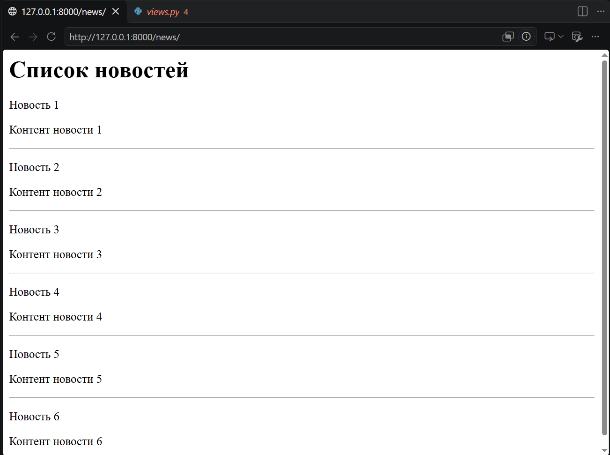
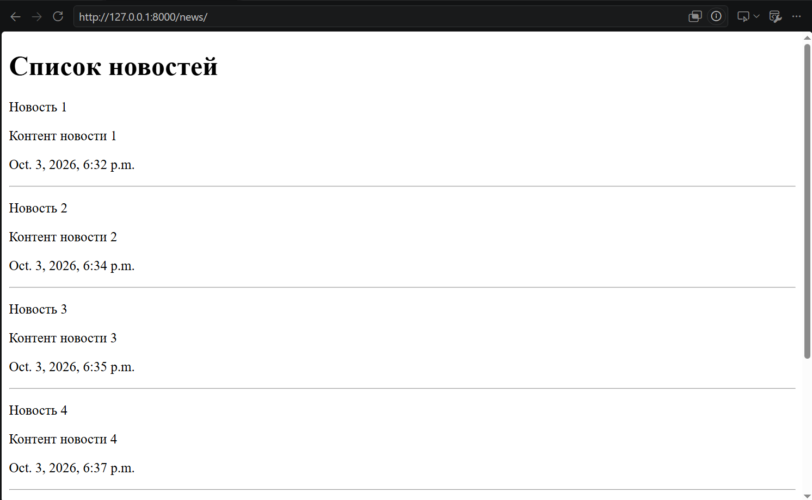
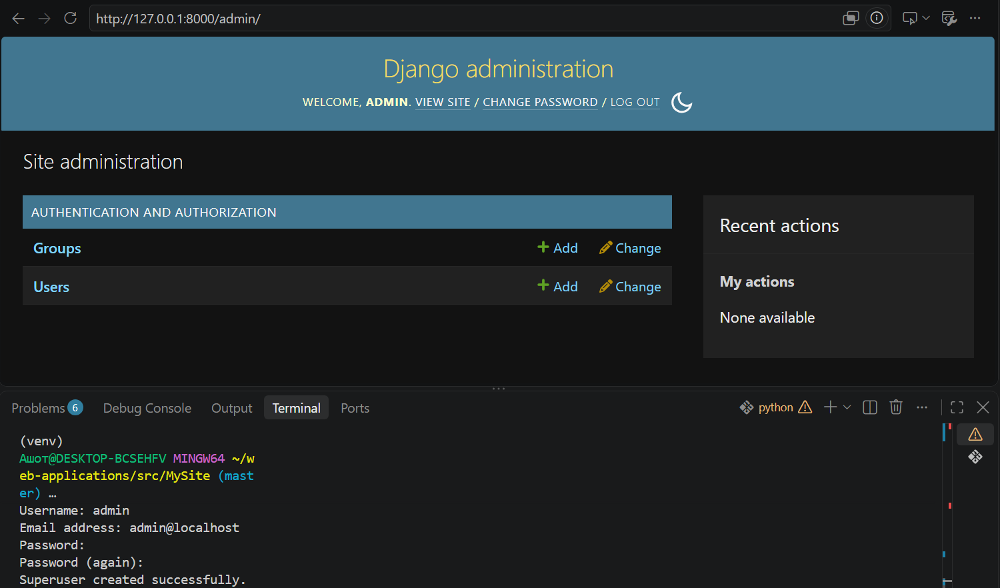
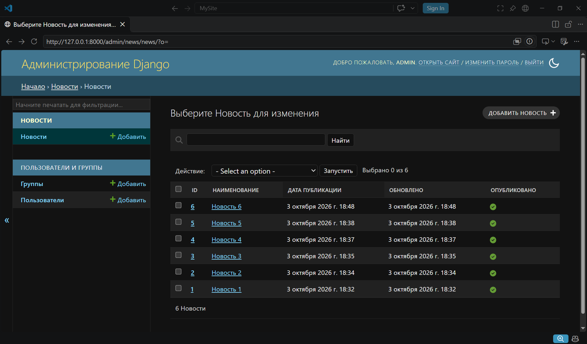

# Лабораторная работа №3: Шаблоны. Админка Django
**Вариант:** 12
**Технология:** Python + Django

## Содержание
- [Лабораторная работа №3: Шаблоны. Админка Django](#лабораторная-работа-3-шаблоны-админка-django)
  - [Содержание](#содержание)
  - [Цель работы](#цель-работы)
  - [Ключевые понятия](#ключевые-понятия)
  - [Скриншоты работы](#скриншоты-работы)
  - [Вывод](#вывод)

## Цель работы
Научиться создавать шаблоны в Django и настраивать админку.

## Ключевые понятия 
**Рендеринг** – процесс, наполнения файла данными из модели, т.е. формирование страницы с данными. Django позволяет рендерить с шаблона и работает с помощью специального шаблонизатора. 

**Контекст** – это словарь, с данными, которые необходимо передать в шаблон. Ключ в словаре можно называть любым именем, но для прозрачности кода, лучше задать его одноименным. 

**Директивы** – это, которые позволяют выводить значения, которые передали в шаблон.

**Фильтры** – механизмы, выполняющие преобразование перед выводом.

## Скриншоты работы

*Список элементов базы данных*

*Список элементов базы данных, выведенных с помощью шаблона и контекста*

*Стандартный интерфейс админки*

*Отформатированный список объектов в админке*

## Вывод 
В ходе выполнения лабораторной работы были получены навыки создания шаблонов и контекстов в Django, а также регистрации и настройки админки для приложения.