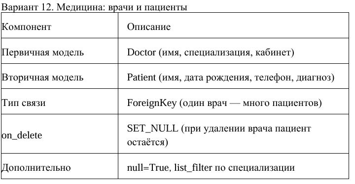
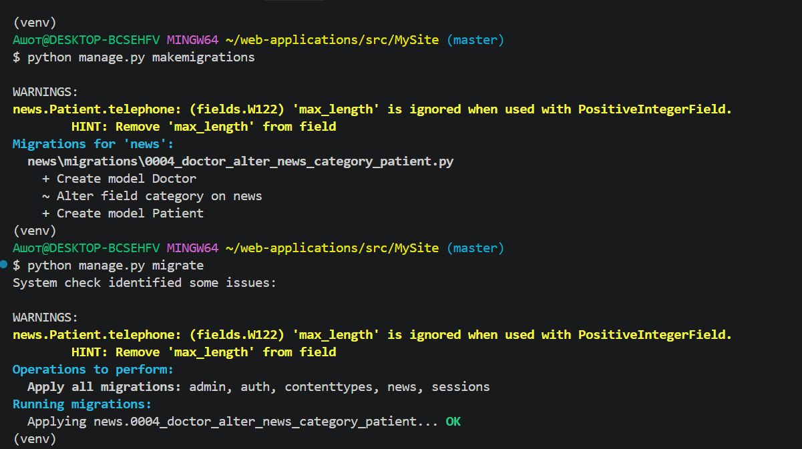
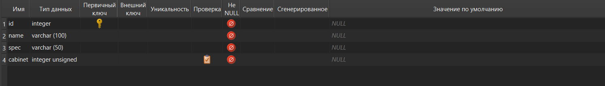
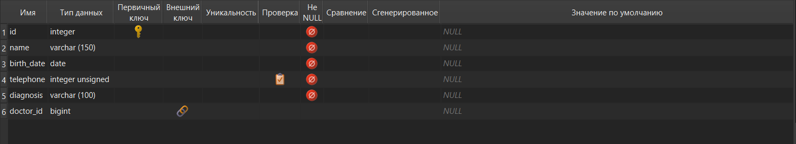
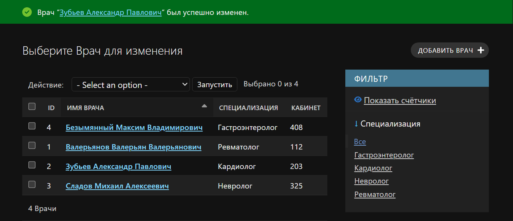
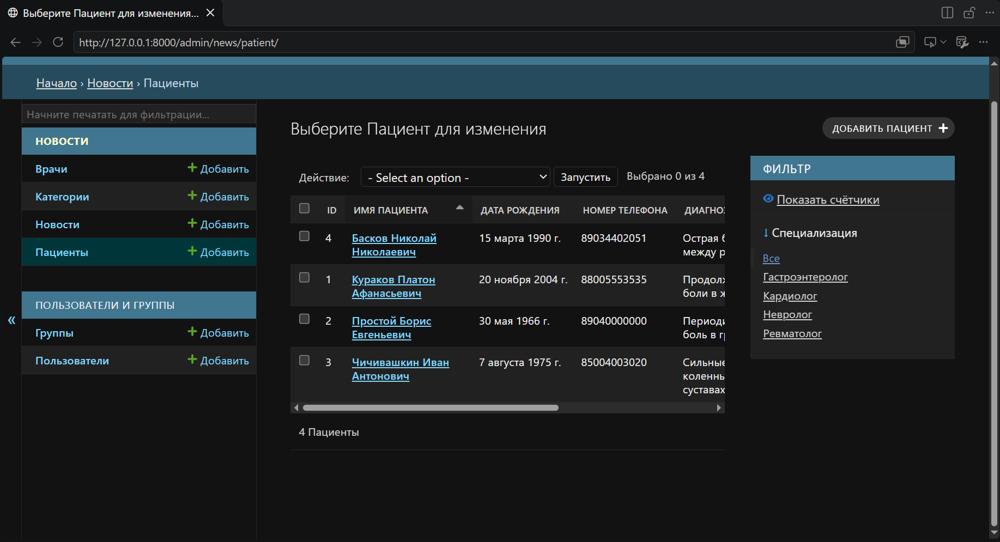
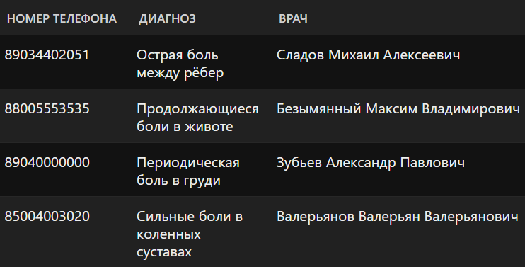

# Лабораторная работа №4: Связи моделей. Внешний вид шаблона
**Вариант:** 12
**Технология:** Python + Django

## Содержание
- [Лабораторная работа №4: Связи моделей. Внешний вид шаблона](#лабораторная-работа-4-связи-моделей-внешний-вид-шаблона)
  - [Содержание](#содержание)
  - [Цель работы](#цель-работы)
  - [Ключевые понятия](#ключевые-понятия)
  - [Выполнение индивидуального задания](#выполнение-индивидуального-задания)
    - [Код для индивидуального задания](#код-для-индивидуального-задания)
  - [Вывод](#вывод)

## Цель работы
Освоить создание и настройку связей между моделями Django (ForeignKey, ManyToManyField, OneToOneField), изучить параметры связей (on_delete, related_name, null, blank, default), научиться применять миграции при добавлении связей к существующим моделям, а также настраивать отображение связанных данных в административной панели Django.

## Ключевые понятия 
**Связь моделей** (Model Relationships) в Django - это способ связать две или несколько моделей между собой, чтобы они могли взаимодействовать через базу данных.
В Django есть 3 основных типа связей.
1. OneToOneField — один к одному: один объект связан только с одним другим объектом.
2. ForeignKey - один ко многим: один объект может быть связан со многими другими объектами.
3. ManyToManyField - многие ко многим: несколько объектов одной модели могут быть связаны с несколькими объектами другой модели.

**Параметры связей** определяют поведение связи, доступ к связанным объектам и возможность оставлять поле пустым.
1. **on_delete** пределяет, что произойдёт со связанными объектами при удалении объекта, на который ссылается ForeignKey или OneToOneField.
2. **related_name** задаёт имя обратной связи, через которую можно получить связанные объекты.
3. **null** определяет, может ли поле хранить NULL в базе данных.
4. **blank** определяет, может ли поле быть пустым при проверке формы и валидации Django.
5. **default** задаёт значение, которое будет использоваться, если пользователь не указал другое.

## Выполнение индивидуального задания

*Условие индивидуального задания*

### Код для индивидуального задания
models.py
``` py
class Doctor(models.Model):
    name = models.CharField(max_length=100, verbose_name='Имя врача')
    spec = models.CharField(max_length=50, verbose_name='Специализация')
    cabinet = models.PositiveIntegerInt(verbose_name='Кабинет')

    class Meta:
        verbose_name = 'Врач'
        verbose_name_plural = 'Врачи'
        ordering = ['name']

    def __str__(self):
        return self.name


class Patient:
    name = models.CharField(max_length=150, verbose_name='Имя пациента')
    birth_date = models.DateField(verbose_name='Дата рождения')
    telephone = models.PositiveCharField(max_length=11, verbose_name='Номер телефона')
    diagnosis = models.CharField(max_length=100, verbose_name='Диагноз')
    doctor = models.ForeignKey(
        Doctor,
        on_delete=models.SET_NULL,
        null=True,
        verbose_name='Врач'
    )

    class Meta:
        verbose_name = 'Пациент'
        verbose_name_plural = 'Пациенты'
        ordering = ['name']
```
___
admin.py
``` py
class DoctorAdmin(admin.ModelAdmin):
    list_display = ('id', 'name', 'spec', 'cabinet')
    list_display_links = ('name')
    list_filter = ('spec')


class PatientAdmin(admin.modelAdmin):
    list_display = ('id', 'name', 'birth_date', 'telephone', 'diagnosis', 'doctor')
    list_display_links = ('name')
    list_filter = ('doctor__spec')
```
___
  
*Миграция созданных моделей*
___
  
*Вид базы данных модели Doctor*
___
  
*Вид базы данных модели Patient*
___
  
*Заполненная таблица врачей*
___
  
*Заполненная таблица пациентов*
___
  
*Заполненная таблица пациентов (правая часть)*

## Вывод 
В ходе выполнения лабораторной работы было освоено создание и настройка связей между моделями Django (ForeignKey, ManyToManyField, OneToOneField), изучены параметры связей (on_delete, related_name, null, blank, default), получены навыки применения миграций при добавлении связей к существующим моделям, а также настроено отображение связанных данных в административной панели Django.