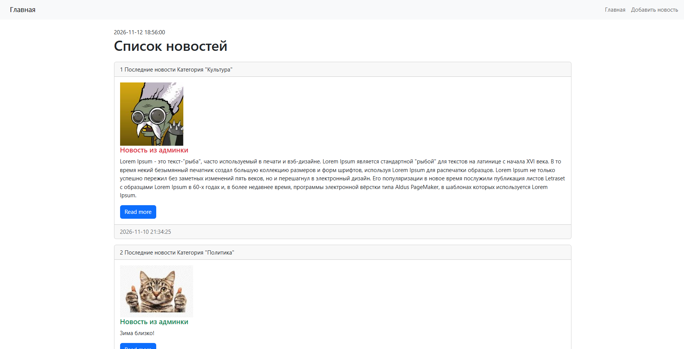

# Лабораторная работа №5: Внешний вид шаблона. Директивы. Теги. Фильтры. 
**Вариант:** 12
**Технология:** Python + Django

## Содержание
- [Лабораторная работа №5: Внешний вид шаблона. Директивы. Теги. Фильтры.](#лабораторная-работа-5-внешний-вид-шаблона-директивы-теги-фильтры)
  - [Содержание](#содержание)
  - [Цель работы](#цель-работы)
  - [Ключевые понятия](#ключевые-понятия)
  - [Итоговый код для index.html](#итоговый-код-для-indexhtml)
  - [Скриншот работы](#скриншот-работы)
  - [Вывод](#вывод)

## Цель работы
Освоить работу с Bootstrap, директивами (условными, циклическими), тегами и фильтрами.

## Ключевые понятия 
**Bootstrap** — это открытый и бесплатный фреймворк для HTML, CSS и JS, который используется веб-разработчиками для быстрой вёрстки адаптивных дизайнов сайтов и веб-приложений.

## Итоговый код для index.html
``` html
<!doctype html>
<html lang="ru" dir="ltr">
<head>
    <!-- Required meta tags -->
    <meta charset="utf-8">
    <meta name="viewport" content="width=device-width, initial-scale=1">

    <!-- Bootstrap CSS -->
    <link rel="stylesheet" href="https://cdn.jsdelivr.net/npm/bootstrap@5.3.9/dist/css/bootstrap.rtl.min.css" integrity="sha384-fFMX5LqaHoT6olm8r/JTe3Dg4+vFEFXrVlhIo8IGs96iA+JhgKLLYwY4y2fHeyMY" crossorigin="anonymous">

    <title>{{title}}</title>
</head>
<body>
    <nav class="navbar navbar-expand-lg bg-body-tertiary">
        <div class="container-fluid">
            <a class="navbar-brand" href="#">Главная</a>
            <button class="navbar-toggler" type="button" data-bs-toggle="collapse"
            data-bs-target="#navbarSupportedContent" ariacontrols="navbarSupportedContent" aria-expanded="false" aria-label="Toggle
            navigation">
                <span class="navbar-toggler-icon"></span>
            </button>
            <div class="collapse navbar-collapse" id="navbarSupportedContent">
                <ul class="navbar-nav me-auto ">
                    <li class="nav-item"><a class="nav-link" href="/">Главная</a></li>
                    <li class="nav-item"><a class="nav-link" href="/">Добавить новость</a></li>
                </ul>
            </div>
        </div>
    </nav>
    <div class="container mt-4">
        
        <h1 class="mb-4">Список новостей</h1>
        
            <div class="card mb-3">
                <div class="card-header">
                    {{forloop.counter}}
                    {{item.my_func}}
                    Категория "{{item.category}}"
                </div>
                <div class="card-body">
                    <div class="media">
                        
                            
                        
                            
                        
                    </div>
                    <div class="media-body">
                        <h5 class="card-title ">{{item.title}}</h5>
                        <p class="card-text">{{item.content}}</p>
                        <a href="#" class="btn btn-primary">Read more</a>
                    </div>
                </div>
                <div class="card-footer text-body-secondary">
                    {{item.created_at|date:"Y-m-d H:i:s"}}
                </div>
            </div>
        
    </div>

    <script src="https://cdn.jsdelivr.net/npm/bootstrap@5.3.0-
    alpha3/dist/js/bootstrap.bundle.min.js" integrity="sha384-
    ENjdO4Dr2bkBIFxQpeoTz1HIcje39Wm4jDKdf19U8gI4ddQ3GYNS7NTKfAdVQSZe"
    crossorigin="anonymous"></script>
    <!-- Optional JavaScript; choose one of the two! -->

    <!-- Option 1: Bootstrap Bundle with Popper -->
    <script src="https://cdn.jsdelivr.net/npm/bootstrap@5.3.9/dist/js/bootstrap.bundle.min.js" integrity="sha384-WyOxWvTyr1QaMPfiPJSv76iReVthorl5uWlFtZPyK0IEB0hGzo9y5Bp9mYanr8Bu" crossorigin="anonymous"></script>

    <!-- Option 2: Separate Popper and Bootstrap JS -->
    <!--
    <script src="https://cdn.jsdelivr.net/npm/@popperjs/core@2.11.8/dist/umd/popper.min.js" integrity="sha384-I7E8VVD/ismYTF4hNIPjVp/Zjvgyol6VFvRkX/vR+Vc4jQkC+hVqc2pM8ODewa9r" crossorigin="anonymous"></script>
    <script src="https://cdn.jsdelivr.net/npm/bootstrap@5.3.9/dist/js/bootstrap.min.js" integrity="sha384-89aa4glufciPv46aKltztWQEmk+Tu9W2RhzXr6VcnUUEub7F8+06RcL2RYLCOHUq" crossorigin="anonymous"></script>
    -->
  </body>
</html>
```
___
## Скриншот работы

*Полностью отредактированный с помощью Bootstrap сайт*

## Вывод 
В ходе выполнения лабораторной работы была освоена работа с Bootstrap, директивами (условными, циклическими), тегами и фильтрами.